# 🪐 Astron Engine

**Engine nativa multi-linguagem 2D/3D construída em C++20 · C# · C11 · GLSL · HLSL · Rust · Lua · CMake**  
*100% Nativa para Desktop e Mobile — zero HTML, zero CSS, zero JavaScript, sem versão Web.*

---

## Arquitetura Nativa Multi-Linguagem

| Subsistema | Linguagem | Diretório | Responsabilidade |
| :--- | :--- | :--- | :--- |
| **Editor Desktop, Renderer 3D & Agente IA** | **C++20** | `engine/include/`, `engine/src/` | Aplicação desktop nativa GLFW + OpenGL 3.3 Core + Dear ImGui, Viewport 3D PBR em Framebuffer (`Viewport3D`), gerenciador `res://` (`ProjectManager`), cliente HTTP nativo (`WinHTTP` / `libcurl`) e **Agente IA Autônomo** (`AIAgent`). |
| **SDK de Jogos & Runtime Multiplataforma** | **C# (.NET)** | `games/AstronGame/` | SDK `Astron.Engine` (`AstronWorld3D`, `SceneNode3D`, `Vec3`, física AABB 2D/3D) e jogos compilados nativamente para **Android (`.apk`)**, **iOS (`.ipa`)**, **Windows (`.exe`)** e **Linux (`x64`)**. |
| **Core Matemático, SIMD & Sintetizador DSP** | **C11** | `engine/core_c/` | Matrizes 4×4 (`astron_math.c`), aceleração por hardware **SSE2 / ARM64 NEON** (`astron_simd.c`), sintetizador de áudio PCM 16-bit `.wav` (`astron_audio.c`), loader dinâmico OpenGL (`astron_gl.c`) e telemetria de SO (`astron_platform.c`). |
| **Shaders GPU OpenGL 3.3 Core** | **GLSL** | `shaders/*.{vert,frag,glsl}` | Céu procedural + grade anti-aliased (`sky_grid`), Cook-Torrance GGX PBR (`pbr_metallic`), holograma sci-fi (`hologram_cyber`), oceano Gerstner (`water_waves`), cel-shading (`toon_cel`) e pós-processamento ACES + Bloom (`post_aces_bloom`). |
| **Shaders DirectX 11 / 12 (Windows)** | **HLSL** | `shaders/hlsl/*.hlsl` | Pipeline Direct3D Shader Model 5.0 PBR (`AstronStandardPBR.hlsl`) e simulação de partículas em Compute Shader (`AstronParticlesCS.hlsl`). |
| **Empacotador Binário `.apak` & FFI** | **Rust** | `engine/tools/astron_pak_rs/` | Ferramenta nativa `astron-pak` e biblioteca estática FFI C para empacotamento, compressão RLE e verificação de integridade FNV-1a 64-bit de arquivos `.apak`. |
| **Scripting Rápido de Comportamentos** | **Lua 5.4** | `engine/scripting_lua/` | Scripts reativos leves (`main.lua` / `astron_behaviors.lua`) para plataformas móveis, coletáveis e ciclos de iluminação. |
| **Sistema de Build Nativo** | **CMake** | `CMakeLists.txt` | Orquestração de compilação C11 + C++20 multiplataforma (Linux GCC/Ninja e Windows MSVC x64) e suíte de testes `ctest`. |

---

## Identidade Oficial & Telas Nativas

1. **Splash Screen** — Fundo espacial escuro, logotipo planetário oficial da **Astron Engine** (`assets/textures/astron-lockup.png`), barra de progresso e transição automática.
2. **Tela de Login** — Horizonte planetário, **Astron Engine** (`Crie. Desenvolva. Explore.`), cartão `Bem-vindo(a)!`, autenticação GitHub e **Configurações** de IA.
3. **Hub Inicial (`Início`)** — Barra lateral com a logo horizontal oficial da **Astron Engine**, seções `Início`, `Meus Projetos`, `Bibioteca`, `Loja`, `Configurações` e `Sobre`, banner `+ Novo Projeto` e `Projetos Recentes` (`Meu Jogo`, `Projeto RP`, `Obby Teste`).
4. **Tela de Compilação (`Compilar`)** — Exportação exclusivamente nativa: **APK** (Android), **IPA** (iOS), **EXE** (Windows), **Linux x64**, **ZIP** e **Outros** (macOS / C++), além de **Build Rápida**.
5. **Editor 3D Completo (`Astron Engine`)** — Cabeçalho superior com o ícone planetário oficial da **Astron Engine** (`astron-icon.png`) e menu **`Astron Engine ▾`**, ferramentas 3D (`Selecionar`, `Mover`, `Rotacionar`, `Escalar`, `Transformar`, `Criar`, `Câmera`, `Iluminação`, `Terreno`, `Componente`, `2D/3D`, `Jogar`, `Pausar`, `Parar`), `Explorer`, `Arquivos (res://)`, Viewport 3D OpenGL com gizmo RGB, editor C#/Lua, `Propriedades`, `Caixa de Ferramentas`, `Console`, `Depurador` (SIMD/C11), sintetizador `Áudio` (`.wav` C11), `Editor de Shader` GLSL ao vivo e **Agente IA**.

---

## Agente IA Autônomo (Qualquer API até OpenRouter)

O painel **Agente IA** (`Ctrl+I` no Editor) conecta-se via C++ nativo (`WinHTTP` no Windows / `libcurl` no Linux) a qualquer provedor de IA até o **OpenRouter**:

- **OpenRouter** (`https://openrouter.ai/api/v1` — Claude, GPT, Gemini, DeepSeek, Llama, Qwen, Mistral...)
- **OpenAI**, **Anthropic**, **Groq**, **Mistral**, **DeepSeek**, **Google Gemini** ou endpoint customizado.
- **Execução 100% Autônoma**: o Agente lê a estrutura do projeto (`list_files`, `read_file`), escreve os scripts **C#** diretamente em `res://scripts/` sincronizados com `games/AstronGame/Core/` (`write_file`) e instancia entidades 3D na cena (`spawn_entity`) sozinho.

---

## Compilando Localmente

### Linux x64 (GCC + Ninja + Cargo)
```bash
sudo apt-get install -y build-essential cmake ninja-build \
  libgl1-mesa-dev libx11-dev libxrandr-dev libxinerama-dev \
  libxcursor-dev libxi-dev libcurl4-openssl-dev

cargo build --release --manifest-path engine/tools/astron_pak_rs/Cargo.toml
cmake -B build -G Ninja -DCMAKE_BUILD_TYPE=Release
cmake --build build --parallel
ctest --test-dir build --output-on-failure
./build/AstronEngine
```

### Windows x64 (Visual Studio 2022 / MSVC + Cargo)
```powershell
cargo build --release --manifest-path engine/tools/astron_pak_rs/Cargo.toml
cmake -B build -A x64
cmake --build build --config Release --parallel
ctest --test-dir build -C Release --output-on-failure
.\build\Release\AstronEngine.exe
```

---

## Pipelines GitHub Actions

- **`.github/workflows/build-engine.yml`** (`🪐 Build Astron Engine`) — Compila e testa o binário nativo **`AstronEngine`** (C++20 / C11 / GLSL) e o empacotador **`astron-pak`** (Rust) para **Windows x64 (`.exe`)** e **Linux x64**.
- **`.github/workflows/build-game.yml`** (`🎮 Build do Jogo`) — Compila os jogos em **C#** gerando pacotes nativos para **Android (`.apk` assinado)**, **iOS (`.ipa`)**, **Windows (`.exe`)** e **Linux (`.tar.gz`)**.
